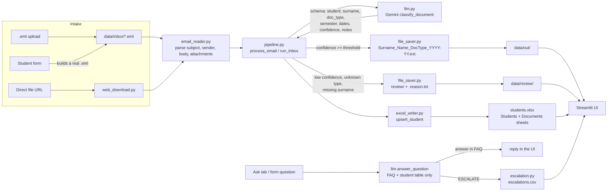
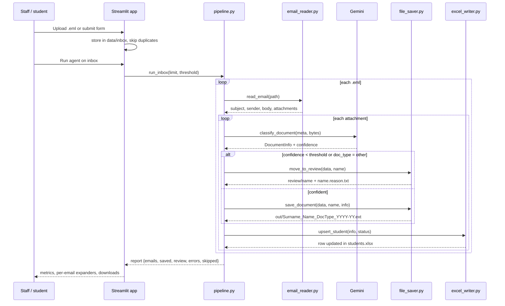
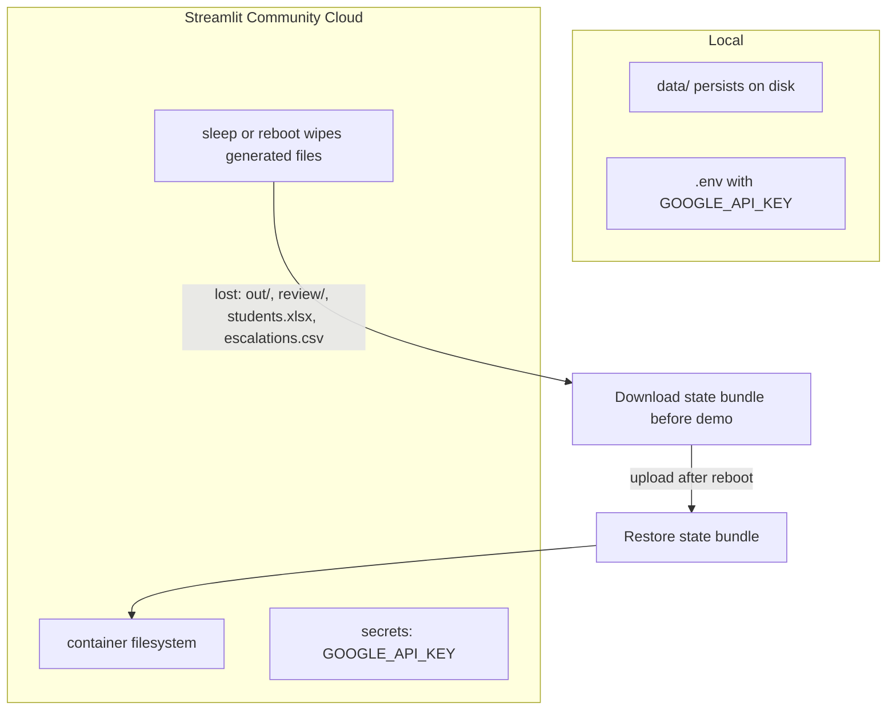

# Erasmus DocFlow — implementation overview

How the project works end to end: intake, classification, renaming, spreadsheet,
FAQ, escalation, persistence and deployment.

## 1. What the system does

The Erasmus office receives messy student emails with scanned documents
(Learning Agreements, transcripts, insurance, arrival certificates). DocFlow:

1. reads `.eml` files or a structured web form,
2. sends each attachment to Gemini for classification,
3. renames the file with a stable pattern,
4. writes one row per student in `students.xlsx`,
5. answers FAQ questions or hands them to a person,
6. lists missing and expired documents.

## 2. Architecture



Solid line = implemented. Every path ends in the same UI tabs, so staff has one
place to review documents, download the spreadsheet and see escalations.
## 3. Email processing sequence



One bad email or attachment never stops the batch: errors are collected per
item and shown in the report.

## 4. Modules

| Module | Responsibility |
|---|---|
| `app.py` | Streamlit UI: Inbox, Student form, Students, Ask, settings, demo state |
| `erasmus_agent/pipeline.py` | Orchestration: one email or whole inbox, saved vs review |
| `erasmus_agent/llm.py` | Gemini calls: classification, FAQ answer, draft reply, model fallback |
| `erasmus_agent/schemas.py` | `DocumentInfo`, `DocType`, required documents, expiry rules |
| `erasmus_agent/config.py` | Paths, model list, limits, API key from env or Streamlit secrets |
| `tools/email_reader.py` | `.eml` parsing, HTML body to text, attachment extraction |
| `tools/inbox_store.py` | Safe `.eml` storage, dedup by content, compose form emails |
| `tools/file_saver.py` | Naming pattern, sanitising, review folder with reason sidecar |
| `tools/excel_writer.py` | Upsert per student, `Documents` detail sheet, missing/expired |
| `tools/faq.py` | Keyword search over `faq.md` |
| `tools/escalation.py` | Append-only CSV of questions for humans |
| `tools/web_download.py` | Direct http(s) file download, HTML and private-host rejection |
| `tools/state.py` | Export, restore and reset the demo data bundle |
| `erasmus_agent/agent.py` | ADK agent exposing the same tools to `adk web` |

## 5. Naming rule

`Surname_Name_DocType_YYYY-YY.ext`

- accents removed, spaces and unsafe characters replaced,
- length capped so Windows paths stay valid,
- semester is normalised (`2026-27`),
- duplicates get a numeric suffix, never overwrite.

Example: `Garcia_Ana_LearningAgreement_2026-27.pdf`.

## 6. Spreadsheet

`students.xlsx` has two sheets.

`Students` — one row per student: `Student`, `Surname`, `Semester`,
`HostUniversity`, `StartDate`, `EndDate`, `Deadline`, `Documents`, `Missing`,
`Status`, `Expired`.

`Documents` — one row per received file: student, type, filename, semester,
university, dates, deadline.

Rules:

- upsert by lowercase `first|surname`, so reprocessing never duplicates rows,
- review rows keep `needs_review` and do **not** invent dates or university,
- `Missing` is computed from `REQUIRED_DOCS` minus received types,
- `Expired` compares the deadline with today.

## 7. Failure handling

| Situation | Behaviour |
|---|---|
| Gemini error or timeout | fallback models, then document goes to review |
| Low confidence / `other` / no surname | review plus `.reason.txt` with confidence and notes |
| Unsupported MIME or empty file | error listed in the report, batch continues |
| Oversized attachment | rejected before the model call, max 15 MB |
| Non-http URL, HTML page, private host | clear warning in the UI, nothing saved |
| 404 / 403 | friendly message, no crash |
| Duplicate upload | detected by content hash comparison, ignored |
| Same email processed twice | saved and review files are reused, no `-2` copies |
| Excel locked or disk error | caught per attachment, reported as error |

## 8. Runtime and persistence



Because the Cloud container is ephemeral, the app can export a single `.zip`
with the spreadsheet, renamed documents, review files and escalations, and
restore it later. Uploaded `.eml` files are not exported: the ten samples live
in the repo and are always available.

The app also offers **Reset demo data**, which clears generated files but keeps
the inbox, so the demo can be replayed.

There is no login and no per-user storage yet: every visitor shares the same
container and sees the same files. Treat the public URL as a demo, not as an
office system.

## 9. Verification

```bash
pytest -q                                    # offline suite
python scripts/check_inbox.py                # parse the inbox, no API calls
python scripts/check_requirements.py         # 15 must-have checks on generated data
RUN_LLM_TESTS=1 pytest tests/test_llm_integration.py -v
```

Manual checks for the deployed app: `docs/QA_CHECKLIST.md`.

## 10. Known limits

- No real mailbox: no IMAP, no SMTP. Replies are drafts downloaded by staff.
- No login, no per-user data, no concurrency lock.
- Supported attachments: PDF, PNG, JPEG, WEBP, HEIC/HEIF. No DOCX, no ZIP.
- Web download only works with direct file links; no crawling, no logins.
- English-only UI and FAQ.
